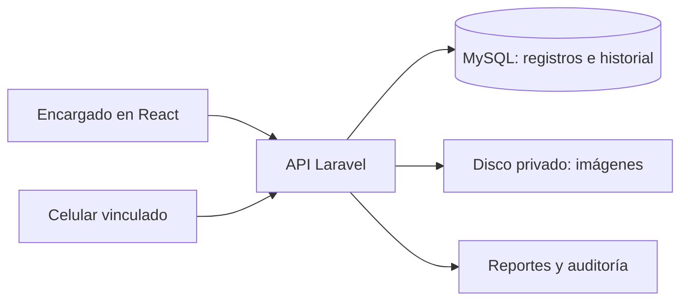

# ALMACEN: análisis y guía del backend por procesos

Fecha de revisión: 2 de noviembre de 2026. Proyecto de prácticas preprofesionales.

Este documento describe el sistema encontrado y organiza el backend pendiente en partes que se pueden desarrollar y sustentar. Es una especificación de trabajo; no significa que los módulos descritos ya estén programados.

## Cómo usar esta guía

| Parte | Contenido | Documento |
|---|---|---|
| 1 | Estado real, evidencias y problemas encontrados | [Diagnóstico](docs/backend/01-diagnostico.md) |
| 2 | Cada proceso: entrada, pasos, reglas y resultado | [Procesos del sistema](docs/backend/02-procesos.md) |
| 3 | Tablas, campos, relaciones e integridad | [Base de datos](docs/backend/03-base-de-datos.md) |
| 4 | Endpoints, permisos, solicitudes y respuestas | [Contrato de API](docs/backend/04-api.md) |
| 5 | Organización Laravel, conexión con React y entregas | [Implementación](docs/backend/05-implementacion.md) |
| 6 | Pruebas, despliegue y evidencias para prácticas | [Validación y entrega](docs/backend/06-validacion-practicas.md) |

## Qué sistema tienes

ALMACEN es un sistema de gestión de archivo documental municipal. Su unidad principal es el **expediente**: se registra, clasifica, ubica físicamente, consulta, etiqueta y digitaliza. También existe un levantamiento físico para observar cajas, tomos, carpetas y paquetes antes de organizar el archivo.

El código revisado no implementa compras, ventas, stock comercial ni kardex de productos. El texto genérico de productos y existencias del login debe adaptarse al propósito documental.

## Estado encontrado

- `C:/Users/JEISON/Documents/ALMACEN`: copia con documentación, dependencias, compilación y receptor PHP; faltan `src/`, `tests/` y `scripts/`.
- `C:/xampp/htdocs/ALMACEN`: contiene el frontend fuente y sus pruebas. Se revisó desde esta ubicación.
- `C:/xampp/htdocs/ALMACEN-BACKEND`: contiene Laravel, Sanctum, modelo de usuario, migraciones técnicas y una ruta de comprobación de base de datos. Todavía no tiene controladores, modelos ni migraciones de expedientes, ubicaciones o digitalización.
- Las versiones bloqueadas en `composer.lock` son Laravel `v13.31.0` y Sanctum `v4.3.3`. Esto acredita las dependencias del proyecto, no que los servicios estén funcionando ahora.
- La interfaz conserva expedientes y estructura en memoria. Las fotografías se reciben en `api/demo.php`, separado de un catálogo documental persistente.

Los documentos anteriores que dicen que Laravel todavía debe instalarse quedaron desactualizados respecto de la carpeta de XAMPP. La siguiente tarea es desarrollar autenticación y módulos de negocio, después de comprobar el entorno existente.

## Orden de trabajo

1. Consolidar una copia completa del proyecto y definir áreas, códigos y permisos.
2. Acceso: login, sesión, logout y autorización.
3. Catálogos: áreas, tipos documentales, estantes, módulos y niveles.
4. Expedientes: registro, edición, movimientos, baja lógica y restauración.
5. Consultas: filtros, mapa, QR, etiquetas e indicadores.
6. Digitalización: vinculación móvil, reservas, imágenes privadas, orden y estados.
7. Levantamiento, exportaciones y reportes.
8. Pruebas integrales, respaldo, instalación y capacitación.

**Primera entrega funcional:** iniciar sesión → registrar un expediente → recargar → consultarlo desde otro equipo autorizado → reubicarlo con historial → imprimir y resolver su QR.

## Supuestos de diseño

Se conserva lo acordado en `planbackend.md`: React + TypeScript, Laravel + MySQL y red municipal. Se propone un administrador técnico y un encargado, con áreas de custodia autorizadas. Área de custodia y área de origen son conceptos diferentes. La nomenclatura de códigos, permisos especiales, año mínimo y reglas institucionales todavía requieren definición con el responsable del archivo.

Para el informe, una formulación coherente del proyecto es: **“Desarrollo e integración del backend de un sistema web de gestión del archivo documental municipal, con registro de expedientes, localización física, identificación QR y digitalización móvil”**.

Esta revisión incluyó código y documentación, comprobación TypeScript sin emisión, sintaxis PHP y el script de alertas existente. No incluyó ejecutar el flujo municipal completo ni probar la conexión MySQL actual. Los resultados y límites están en la parte 6.
