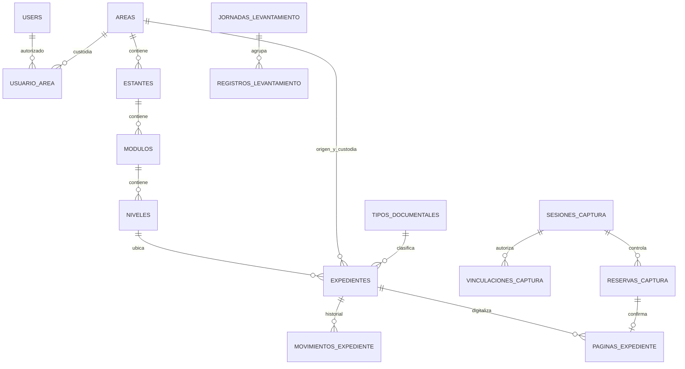

# Parte 3. Modelo de base de datos

[Volver al índice](../../ANALISIS_BACKEND.md)

Este es un diseño lógico propuesto para las migraciones pendientes. No se ejecutó SQL ni se modificó una base de datos durante el análisis.

## 1. Convenciones

- Conservar `users` y su clave numérica existente para evitar una conversión innecesaria del arranque Laravel. La API puede usar nombres de rutas en español.
- Para entidades documentales, usar UUID generado en el servidor; no regenerarlo al editar ni al reubicar.
- Claves de usuario: `BIGINT UNSIGNED`; claves UUID relacionadas: mismo tipo y longitud en ambos extremos.
- MySQL con InnoDB y `utf8mb4`; fijar una intercalación consistente. Normalizar códigos con trim y mayúsculas antes de validar unicidad.
- Fechas de eventos en UTC y presentación en `America/Lima`; fechas documentales y de jornada como `DATE`, sin conversión horaria.
- `created_at` y `updated_at` en registros editables; `deleted_at` solo donde exista baja lógica.
- El servidor asigna usuario, fechas, estado interno y versión. Validar una lista explícita de campos editables.
- Referencias documentales e historial usan restricciones de eliminación; no aplicar cascadas que destruyan evidencia.

## 2. Tablas por entrega

| Entrega | Tablas |
|---|---|
| Acceso | Ampliación de `users`, `instituciones`, `areas`, `usuario_area`; reutilizar `sessions` |
| Catálogo documental | `tipos_documentales`, `estantes`, `modulos`, `niveles`, `correlativos`, `expedientes`, `movimientos_expediente`, `auditoria`, `operaciones_idempotentes` |
| Captura | `sesiones_captura`, `vinculaciones_captura`, `reservas_captura`, `paginas_expediente`, `eventos_captura` |
| Levantamiento | `jornadas_levantamiento`, `registros_levantamiento` |
| Solo si el volumen lo exige | `exportaciones` y uso de `jobs`/`failed_jobs` |

`operaciones_idempotentes` es una ampliación propuesta al plan anterior para proteger, por ejemplo, altas reenviadas después de una pérdida de respuesta. No sustituye la restricción específica de capturas.

## 3. Acceso, institución y catálogos

| Tabla | Campos principales | Restricciones |
|---|---|---|
| `instituciones` | `id`, `nombre varchar(200)`, `jurisdiccion varchar(120)`, `activo` | Una institución inicial; la jurisdicción es configuración |
| `areas` | `id`, `institucion_id`, `codigo varchar(30)`, `nombre varchar(150)`, `activo` | Único `(institucion_id,codigo)` |
| `users` | Campos actuales; añadir `rol varchar(30)`, `activo boolean` | Email único; roles iniciales administrador/encargado |
| `usuario_area` | `user_id`, `area_id` | Clave única compuesta; determina custodia autorizada |
| `tipos_documentales` | `id`, `institucion_id`, `codigo varchar(30)`, `nombre varchar(150)`, `abreviatura varchar(20)`, `activo` | Código único por institución |
| `estantes` | `id`, `area_custodia_id`, `codigo varchar(30)`, `nombre varchar(100)`, `descripcion`, `activo` | Único `(area_custodia_id,codigo)` |
| `modulos` | `id`, `estante_id`, `codigo varchar(30)`, `nombre varchar(100)`, `activo` | Único `(estante_id,codigo)` |
| `niveles` | `id`, `modulo_id`, `codigo varchar(30)`, `orden int`, `activo` | Único `(modulo_id,codigo)`; orden positivo |

Los nombres que hoy representan módulos —por ejemplo, “Contabilidad”— pueden conservarse como etiquetas físicas. Su identidad física no debe convertirse automáticamente en un área administrativa.

El sistema valida que custodia, origen y tipo pertenezcan a la misma institución. Además, el nivel debe depender de un estante de la custodia del expediente. Una FK simple a `niveles` no garantiza esta última regla: debe verificarse al crear/mover, evitando cambiar de padre ubicaciones utilizadas; si se permiten transferencias futuras, exigir invariantes equivalentes en su transacción.

## 4. Diccionario de `expedientes`

| Campo | Tipo propuesto | Regla |
|---|---|---|
| `id` | UUID | PK estable; base del QR |
| `area_custodia_id` | UUID FK | Obligatorio; autorizado para el actor |
| `area_origen_id` | UUID FK | Obligatorio en nuevas altas; no inferir de ubicación |
| `tipo_documental_id` | UUID FK | Obligatorio y activo para nuevas altas |
| `nivel_id` | UUID FK | Ubicación actual, activa para altas y movimientos |
| `codigo` | `varchar(60)` | Asignado por servidor, único por custodia |
| `codigo_referencia` | `varchar(120)`, nullable | Código anterior o externo; puede repetirse |
| `anio_documental` | `smallint unsigned` | Rango institucional por definir |
| `tomo` | `varchar(20)`, nullable | Texto normalizado; no forzar conversión destructiva |
| `folio_desde` | `varchar(10)`, nullable | Dígitos; ambos extremos presentes o ambos nulos |
| `folio_hasta` | `varchar(10)`, nullable | Valor numérico mayor o igual al inicial |
| `observaciones` | `text`, nullable | Límite de aplicación propuesto: 5000 caracteres |
| `jurisdiccion_documental` | `varchar(120)`, nullable | Solo si describe al documento; la institucional está en `instituciones` |
| `estado_digital` | `varchar(20)` | `SIN_INICIAR`, `EN_PROCESO`, `PENDIENTE`, `FINALIZADO` |
| `version` | `int unsigned` | Inicia en 1; aumenta con cambios que afectan detalle, ubicación o galería |
| `created_by`, `updated_by` | FK a `users` | Actor obtenido de la sesión |
| `created_at`, `updated_at` | datetime | Fechas del servidor |
| `deleted_at`, `deleted_by`, `motivo_baja` | nullable | Baja lógica trazable |

Las longitudes son límites de diseño ajustables antes de programar. Conservar `001` en folios, pero comparar valores numéricos tras validar dígitos y longitud. No interpretar folios como número de fotografías: una imagen puede representar una cara, un anexo o una repetición.

Los expedientes antiguos con procedencia desconocida no deben recibir un área inventada durante una importación. Se prepara una zona de importación pendiente o una decisión explícita de tratamiento antes de incorporarlos al catálogo válido.

## 5. Códigos, historial y auditoría

| Tabla | Campos principales | Integridad |
|---|---|---|
| `correlativos` | `id`, `area_custodia_id`, `periodo`, `ultimo_valor bigint` | Único `(area_custodia_id,periodo)`; bloqueo al incrementar |
| `movimientos_expediente` | `id`, `expediente_id`, `nivel_anterior_id nullable`, `nivel_nuevo_id`, `origen_snapshot json`, `destino_snapshot json`, `motivo`, `user_id`, `created_at` | Movimiento inicial sin origen; historial no editable por API |
| `auditoria` | `id`, `user_id nullable`, `vinculacion_id nullable`, `accion`, `entidad`, `entidad_id`, `cambios json`, `request_id`, `created_at` | Minimizar datos; nunca guardar secretos |
| `operaciones_idempotentes` | `id`, `user_id`, `operacion`, `clave`, `request_hash`, `estado`, `recurso_id`, `http_status`, `expires_at` | Único `(user_id,operacion,clave)`; comparar hash antes de repetir respuesta |

Propuesta de código: `ARC-2026-000125`. El periodo 2026 representa el año de registro en este ejemplo, aunque el documento sea de 2021. Si distintas custodias comparten prefijo, el código puede repetirse entre custodias; resolver texto deberá considerar el ámbito y devolver candidatos. El QR por ID siempre evita esa ambigüedad.

La creación inicial de una fila de correlativo también puede competir: protegerla con su índice único y una inserción segura con relectura/reintento antes de bloquear. No usar `count()+1` ni `MAX()+1` sin control. La baja de un expediente no libera su código.

## 6. Digitalización

| Tabla | Campos principales | Restricciones y uso |
|---|---|---|
| `sesiones_captura` | `id`, `propietario_id`, `area_custodia_id`, `expediente_activo_id nullable`, `estado`, `revision`, `secuencia`, `expires_at`, `closed_at` | Estados ABIERTA/CERRADA/VENCIDA; revisión cambia al cambiar la selección; secuencia con eventos |
| `vinculaciones_captura` | `id`, `sesion_id`, `codigo_hash nullable`, `codigo_expires_at`, `canjeado_at`, `credencial_hash nullable`, `dispositivo`, `expires_at`, `revoked_at`, `last_seen_at` | Código de un uso; credencial hasheada; no devolver hashes al cliente |
| `reservas_captura` | `id`, `sesion_id`, `vinculacion_id`, `expediente_id`, `capture_id`, `revision`, `estado`, `expires_at`, `pagina_id nullable`, `checksum nullable` | Único `(sesion_id,capture_id)`; RESERVADA/RECIBIENDO/CONFIRMADA/CANCELADA/VENCIDA/FALLIDA |
| `paginas_expediente` | `id`, `expediente_id`, `sesion_id nullable`, `reserva_id`, `ruta_privada`, `ruta_temporal nullable`, `nombre_original`, `mime`, `bytes`, `ancho`, `alto`, `checksum_sha256`, `orden nullable`, `estado`, `created_by`, `vinculacion_id nullable`, fechas y baja lógica | `reserva_id` único; orden positivo para confirmadas; estados PENDIENTE/CONFIRMADA/FALLIDA/RETIRADA |
| `eventos_captura` | `id`, `sesion_id`, `secuencia`, `tipo`, `datos json`, `created_at` | Único `(sesion_id,secuencia)`; datos mínimos |

La credencial de cookie no es el ID de vinculación. Un código de emparejamiento se consume de forma atómica, y se reemplaza por una credencial aleatoria diferente. El middleware de captura verifica hash, sesión, expiración y revocación en cada llamada.

Propuesta inicial: una sesión activa por expediente y una reserva activa por sesión. Proteger estas reglas bloqueando el expediente y la sesión al activar/reservar. Todas las rutas implicadas deben adquirir bloqueos en el mismo orden para reducir interbloqueos. Al expirar una sesión, liberar sus reservas y dejar el expediente pausado.

No se intenta aplicar una supuesta transacción única de MySQL y disco: `PENDIENTE` representa una escritura todavía no confirmada. Solo páginas `CONFIRMADA`, no retiradas y con archivo verificable, cuentan y aparecen en la galería.

## 7. Levantamiento y exportaciones

| Tabla | Campos principales | Reglas |
|---|---|---|
| `jornadas_levantamiento` | `id`, `area_custodia_id`, `responsable_id`, `fecha`, `descripcion`, `estado`, `version`, `closed_at` | ABIERTA/CERRADA; reapertura auditada |
| `registros_levantamiento` | `id`, `jornada_id`, `estante_observado`, `modulo_observado`, `nivel_observado nullable`, `nivel_id nullable`, `area_origen_id nullable`, `area_origen_observada`, `tipo_documental_id nullable`, `tipo_observado`, `anio`, `cantidad int unsigned`, `unidad`, `notas`, `version`, autores, fechas y baja lógica | Cantidad positiva; preservar textos observados; IDs opcionales permiten normalización posterior |
| `exportaciones` — opcional | `id`, `user_id`, `tipo`, `filtros json`, `estado`, `ruta_privada`, `expires_at`, `error_resumido` | Descarga del propietario autorizado; volver a comprobar permisos al descargar |

No reutilizar `expedientes` como tabla de cajas observadas. Una futura conciliación debe conservar qué observación dio origen a cada expediente, con una relación explícita.

## 8. Relaciones centrales

El diagrama resume relaciones. `areas` tiene dos relaciones distintas con cada expediente: origen y custodia. La autorización se basa en custodia.

## 9. Índices y concurrencia

Comenzar con índices para `(area_custodia_id,deleted_at,created_at,id)`, `(area_custodia_id,anio_documental)`, `(area_custodia_id,estado_digital)`, `(nivel_id,deleted_at)`, código/referencia normalizados y `(expediente_id,created_at)` en movimientos. Ajustar con consultas y volumen reales; no crear todas las combinaciones posibles.

Para páginas, índice `(expediente_id,estado,orden)` y unicidad de orden activo si se decide imponerla en SQL. Una opción es `UNIQUE(expediente_id,orden)` con `orden=NULL` para retiradas o pendientes. El reordenamiento deberá pasar temporalmente por valores libres dentro de una transacción con el expediente bloqueado; intercambiar directamente dos valores únicos puede fallar.

Agregar índices de vencimiento en sesiones, vínculos y reservas. Las búsquedas por texto parcial pueden necesitar otra estrategia al crecer; medir antes de incorporar búsqueda especializada.

La comprobación de versión debe ser atómica: bloqueo de fila y comparación dentro de la transacción, o `UPDATE ... WHERE id=? AND version=?` comprobando filas afectadas. Comparar versión antes de entrar a la transacción no evita carreras.
